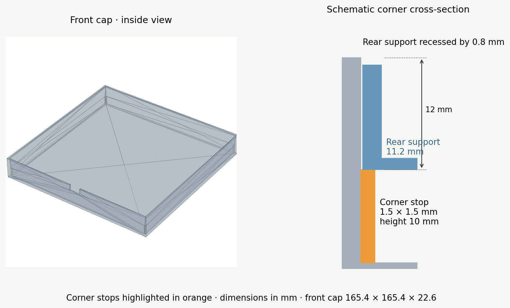

# Enclosure fabrication release

This directory contains the final available two-part enclosure package for the
Physical Community Light. Dimensions are in millimetres.



## Final geometry

| Feature | Dimension |
| --- | --- |
| Front-cap outer size | 165.4 × 165.4 × 22.6 mm |
| Front-cap internal width and depth | 161.4 × 161.4 mm |
| Front diffuser thickness | 0.6 mm |
| Cap wall thickness | 2.0 mm |
| Corner stops | Four, each 1.5 × 1.5 × 10.0 mm |
| Rear-support outer size | 161.0 × 161.0 × 11.2 mm |
| Side clearance | 0.2 mm per side |
| USB notches | 12 mm wide × 7 mm deep |
| Rear wiring opening | 18 × 18 mm, approximately 1 mm corner radius |

The four stops begin on the inner face of the 0.6 mm diffuser and end at
Z = 10.6 mm. With the rear support resting directly on them, its walls end at
Z = 21.8 mm, 0.8 mm below the cap rim. If the rear support is instead aligned
with the cap rim, the same 0.8 mm becomes the nominal space between the stops
and the rear support for the LED-panel and adhesive stack. See
`docs/dimensioned_section_flush_en.svg` for the dimensioned section.

## Files

- `printable/part_2_front_cap_with_corner_stops.stl` — final front cap for
  slicing.
- `printable/part_1_rear_with_openings.stl` — rear LED support.
- `source/part_2_front_cap_with_corner_stops.scad` — editable final cap.
- `source/part_2_front_cap_with_usb.scad` — base cap used by the generator.
- `source/part_1_rear_with_openings.scad` — editable rear support.
- `source/generate_corner_stops.py` — regenerates the final SCAD, STL, and
  assembly check using OpenSCAD.
- `assembly/assembly_fit_check_final.scad` — seated assembly preview; increase
  `exploded_gap` to separate the parts.
- `docs/` — overview and dimensioned drawings.

## Regeneration and printing

Install Python 3 and OpenSCAD, then run from the repository root:

```sh
python3 enclosure/source/generate_corner_stops.py
```

Import the STL files in millimetres. Print the front cap with its flat diffuser
on the build plate and the open side facing upwards.

The supplied front-cap STL is a closed, consistently oriented, single solid
with the expected 165.4 × 165.4 × 22.6 mm bounds. The four stops add 90 mm³ of
material to the base OpenSCAD cap. Physical fit and the actual combined
thickness of the LED panel and adhesive still require a test assembly.
